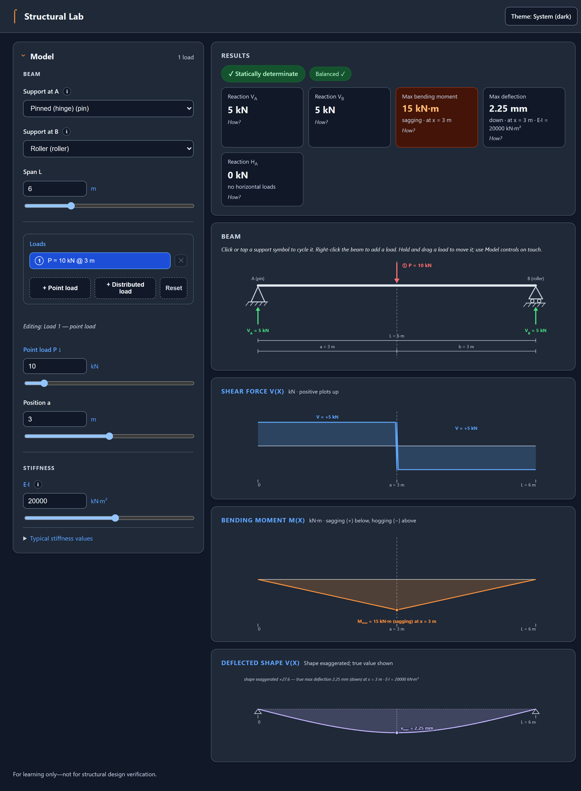
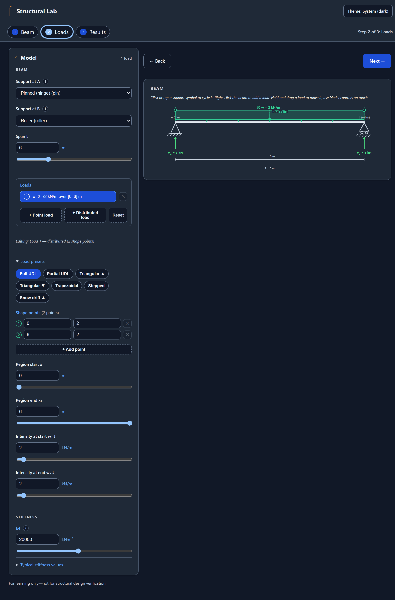
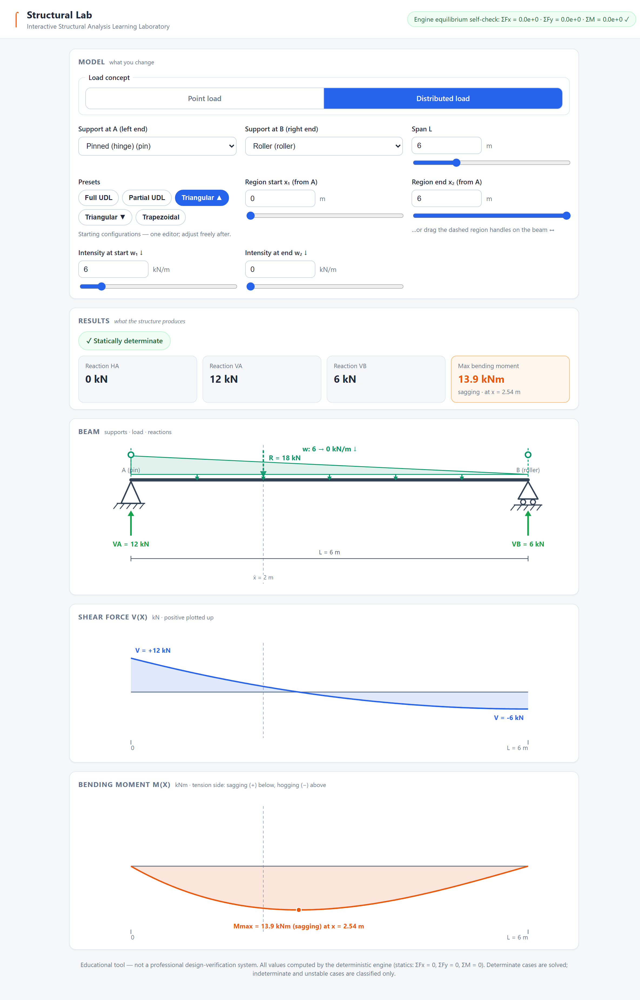

# Structural Lab

Interactive Structural Analysis Learning Laboratory — educational software for
civil/structural engineering students, built around the loop
**Experiment → Observe → Question → Understand**.

> **The engineering engine calculates. AI explains.** Deterministic mathematics
> produces every structural result; the AI tutor layer (a future milestone) will
> only ever interpret and explain those results — never compute them.

| Point load | Full-span UDL | Triangular load |
|---|---|---|
|  |  |  |

## Status

- **Milestone 1 — complete**: deterministic engine (simply supported beam, one
  downward point load) + analytical test suite.
- **Milestone 2 — complete**: interactive visualization layer (beam, supports,
  draggable load, live SFD/BMD, reactions, equilibrium check).
- **Milestone 3 — complete**: support & boundary-condition laboratory
  (pin / roller / fixed / free; solves determinate, classifies indeterminate &
  unstable).
- **Milestone 4 — complete**: distributed load laboratory — **full-span UDL**.
  - Point load (`P`, kN) and UDL (`w`, kN/m) selectable; total load `W = w·L` (kN).
  - Linear shear, parabolic moment; sagging `wL²/8` (simply supported) and
    hogging `wL²/2` (cantilever) solved exactly.
- **Milestone 5 — complete**: non-uniform distributed loads (one `linear`
  descriptor) + UI consolidation.
  - **Two load concepts** in the UI: **point load** (`P` at `a`) and
    **distributed load** (one region `[x₁, x₂]` with endpoint intensities
    `w₁ → w₂`). Full UDL / partial UDL / triangular / trapezoidal are
    **presets** that fill the single distributed editor — not separate modes
    or control groups.
  - Every distributed load shows its **resultant `R`** (kN) and **centroid `x̄`**
    (m) **on the beam** (contextual), keeping the Results panel to reactions +
    Mmax.
  - Reactions from `(R, x̄)`; piecewise shear (quadratic inside) and moment
    (cubic inside) solved in closed form; peak moment at the analytic `V = 0`
    root. Full-span uniform `linear` ≡ M4 UDL.
- **Milestone 6 — complete**: combined / multiple downward loads (superposition).
  - Any mix of 1–6 loads (point + distributed together, several point loads,
    overlapping distributed regions) on the existing `loads` array.
  - Reactions from the **combined resultant** `R = ΣRᵢ`, `x̄ = ΣRᵢx̄ᵢ/R` —
    "N loads → one equivalent force" is drawn on the beam.
  - Shear `V(x) = RA − ΣCᵢ(x)` and moment `M(x) = RA·x − ΣFᵢ(x)` superpose
    closed-form kernels; point-load shear **jumps** and distributed-load
    kinks coexist in the sampled arrays. Peak moment found analytically on
    every segment (no numerics).
  - Load-list UI: one row per load (select / add / remove); the classic
    single-load editor is the one-row case. Numbered badges ①–⑥ tie the
    beam drawing to the list.
- **Milestone 7 — complete**: arbitrary `w(x)` — piecewise-linear **profile**
  loads from a list of 2–6 control points.
  - One distributed load can be **stepped, gapped or ramped from mid-span**:
    the intensity follows the polyline through the control points, is zero
    outside the first and last point, and a repeated `x` is a **vertical
    step** (intensity jump).
  - Resultant by **per-segment summation** of the M5 closed forms
    (`R = ΣRᵢ`, `x̄ = ΣRᵢx̄ᵢ/R`); kernels reuse the M6 two-function contract;
    the peak search is M6's segment-exact `V = 0` machinery fed more events.
    Every integral exact — no numerics, no new dependencies.
  - **Emit rule (the frozen boundary):** a two-point load emits the M5
    `linear` descriptor byte-for-byte; only 3+ points (or a step) emit
    `profile`. Every M5/M6 screen, label and number stays identical.
  - UI: a **shape-point table** (`x | w` rows, + Add point, per-row remove)
    edits 3+-point loads; two-point loads keep the flat M5 editor. One drag
    handle per control point (along the beam **and** up/down); two new preset
    chips (**Stepped**, **Snow drift ▲**); point cap 6.
- Roadmap after M7: deflection / E·I (elastic curve) → UI consolidation pass →
  AI tutor layer.
- **Milestone 8 — complete**: **deflection / elastic curve (E·I)**.
  - A fourth diagram panel draws the beam's **deflected shape** (exaggerated,
    with the factor and the true scale printed), plus a **Max deflection**
    card in mm with its position and sign.
  - One new input: **beam stiffness E·I** (kN·m²) with four teaching preset
    chips (Steel / Timber / Concrete / Default) and a logarithmic slider.
    Change it and watch the beam sag more or less — the Experiment→Observe
    loop at its most physical.
  - The curve is **exact**: the moment diagram is integrated twice in closed
    form per load kernel (point / udl / linear / profile all elementary),
    constants pinned by the support conditions. The max-sag turning point
    uses the one bounded root-finder the M6 plan sanctioned (θ = 0 bisection).
  - **Down-positive convention:** v and θ are reported positive downward (a
    sagging beam deflects downward); EI·v″ = −M in this convention.
  - Honesty unchanged: determinate beams only; indeterminate/unstable keep
    the placeholder and hide the E·I control.
- **Milestone 10 — complete**: responsive app shell, foldable Model editor, System/Light/
  Dark preference, and the equilibrium check beside Results. The M10 checkpoint was
  committed and pushed separately; it changed no calculations.
- **Milestone 11 — complete**: minimalist hierarchy and spacing,
  concise copy, optional preset disclosures, and a centered accessible one-topic teaching
  dialog with in-context glossary links and a Back trail. The dialog opens only on
  activation, inerts the whole page background, traps focus and restores focus/state on
  close. E·I stays visible for every determinate load kind. Full browser verification
  (2026-09-29) is recorded in `plan-m11.md` §7.
- **Teaching layer (M9, refined after M11):** activate a marked term or info button to
  read its hand-written explanation; blue inline links open related definitions in the
  same dialog, with Back through the exploration trail. Result cards still open worked
  explanations. Standard cases show valid equations and substitutions. Mixed/profile
  cases show actual inputs and method, with engine outputs kept distinct from the
  method—no fabricated intermediate values. Unsolved beams explain why without inventing
  results.
- New teaching modules remain `src/glossary.js` (dictionary), `src/explain.js` (formatter
  over completed results) and `ui/popover.js` (reusable accessible dialog).
- Roadmap after M11: future AI tutor layer; the current lab remains useful on its own.

## Application shell (M10)

- The **beam is the first, full-width workspace**: drag a load and watch the beam and
  diagrams respond. Results follow it, then the folded Model editor for deeper edits.
- On smaller screens these areas stack in the same beam → results → model order. The
  Model disclosure keeps advanced controls available without competing with the first
  experiment.
- The Model editor can be folded and reopened without resetting any inputs. Its heading
  shows the current load count. The equilibrium self-check now sits with Results.
- The appearance button cycles **System → Light → Dark** and remembers only this visual
  preference. System follows the device setting; theme storage is optional, so blocked
  browser storage does not prevent the lab from working.
- Labels were shortened only where they repeated information. Units, sign conventions,
  true deflection values, result names, explanations and the educational disclaimer
  remain available. M10 changed no engineering calculations.

## Quick start

Requires Node.js ≥ 18. Zero dependencies, no install step.

```bash
npm start      # start the app → http://localhost:8000 (browser opens)
npm test       # run the full automated suite
npm run demo   # ASCII text demo of the engine (Milestone 1)
```

> ⚠️ Open the app via `npm start`, not by double-clicking `ui/index.html` —
> browsers block ES-module imports over `file://`.

**Testing & quality:** Node's built-in test suite (`npm test`) covers analytical cases
with independently known textbook values, rendering, accessible teaching, shell/theme
checks, and source guards proving the UI contains no engineering formulas. The browser suite in [`verify/`](verify/readme.md) covers controls, calculations, dialogs,
themes and responsive layouts. The complete M5–M11 browser regression matrix passed serially on 2026-09-29: all
functional and layout assertions passed — M11 teaching 47/47, M10 shell 22/22, M5 consolidation
32/32, M6 multi-load 22/22, M7 profile 30/30, M8 deflection 15/15, and all five layout audits
clean (27 shell checks, 6/6, 6/6, 8/8, 8/8) — with no browser console/runtime errors and
`verify/tmp/` empty after the run. The unit suite stood at 188/188 in the same state.
CI runs the unit suite on Node 20 and 22 against a case-sensitive filesystem.
Educational tool — **not** a professional design-verification system.

## License

[MIT](LICENSE)

## What you can do

- **Pick a load concept**: **point load** (`P` at `a`, draggable arrow) or
  **distributed load**. A two-point distributed load keeps the M5 editor
  (region `[x₁, x₂]`, intensities `w₁ → w₂`, two **draggable region handles**);
  add points with **+ Add point** and the editor becomes the **shape-point
  table** (`x | w` per row, remove buttons, cap 6) — the load can then be
  **stepped, gapped or ramped from mid-span**, with **one drag handle per
  control point** (along the beam and up/down). **Preset chips** (Full UDL,
  Partial UDL, Triangular ▲/▼, Trapezoidal, **Stepped**, **Snow drift ▲**)
  fill the distributed editor — the beam stays the primary workspace.
- **Set how stiff the beam is** with **E·I** (kN·m²) — one number, a
  logarithmic slider, and teaching preset chips (steel / timber / concrete /
  default). Watch the **deflected shape** panel sag more or less, with the
  true max deflection (mm) printed on the drawing and on a results card.
- **Choose the two end supports** (A left, B right) from pin / roller / fixed /
  free — symbols, reactions and determinacy verdict update instantly.
- Adjust **span L**, **load magnitude**, and (for a point load) **position a**
  via sliders or number fields. Everything updates **immediately**.
- See the **determinacy badge**, the **reaction components** (H / V / M),
  **Mmax** (with sagging/hogging sign), and the engine's **equilibrium
  self-check** (ΣFx = ΣFy = ΣM = 0).
- For any distributed load, the **beam** shows **intensity `w₁ → w₂`**, the
  **resultant `R`** (equivalent single force) and its **centroid `x̄`** — the
  educational “replace the load with one force at its centroid” concept, drawn
  on the diagram rather than as separate result cards.
- Indeterminate / unstable cases explain *why* instead of fabricating numbers.

## Architecture

```
src/engine.js        deterministic point-load solver (PURE) — Milestone 1, FROZEN
src/supportmodel.js  support catalog + determinacy/stability classification — M3
src/loadmodel.js     load-type catalog + descriptor normalization (1..6 loads) — M4–M7
                     (M7: `profile` descriptor, `MAX_PROFILE_POINTS`, `emitDescriptor`)
src/analysis.js      analyzeBeam() dispatcher: point/UDL/linear solvers + combined (M6)
                     + profile kernels & routing (M7) + elastic curve (M8)
src/glossary.js      M9 teaching dictionary — hand-written explanations (pure data)
src/explain.js       M9 derivation formatter over finished results (reads, never recomputes)
src/demo.js          ASCII demo of the engine (M1)
ui/index.html        responsive shell (M10), minimalist hierarchy/copy (M11), model
                     controls (load list M6, shape-point table M7, E·I M8), teaching triggers (M9/M11)
ui/app.js            interaction orchestration + engine adapter (ONLY caller of
                     analyzeBeam): solve→render loop, load list, flat distributed
                     editor, shape-point table, E·I, presets, supports, sliders, boot
ui/state.js          the single UI state object + pure state logic (accessors,
                     invariant repairs, last-solved result store) — DOM-free
ui/drag.js           beam pointer/keyboard drag wiring + desktop context menu
                     (guarded by test/interaction-guard.test.js; actions injected by app.js)
ui/teaching.js       M9 teaching-layer bootstrap (reads the last result from state.js)
ui/theme.js          M10 System / Light / Dark preference (presentation only)
ui/popover.js        M11 centered one-topic dialog (a11y, inert background, focus lifecycle)
ui/render.js         M2 reference renderers (simply supported point load) — FROZEN
ui/renderm3.js       support/load renderers (multi-load M6, profile M7, deflection M8,
                     theme tokens M10, concise status + accessible diagram triggers M11)
ui/style.css         responsive layout + light/dark colors (M10), minimalist shell and
                     centered teaching dialog (M11)
server.js            zero-dependency static server (Node http module)
test/engine.test.js        M1 analytical (9)
test/ui-smoke.test.js      M2 render (5)
test/supportmodel.test.js  M3 classification (6)
test/analysis.test.js      M3 solver (8)
test/ui-m3.test.js         M3 render (5)
test/loadmodel.test.js     M4/M5/M6 load normalization (13)
test/udl.test.js           M4 UDL solver (9)
test/ui-m4.test.js         M4 UDL render (4)
test/linear.test.js        M5 linear solver (11)
test/ui-m5.test.js         M5 linear render (7)
test/multi.test.js         M6 multi-load solver (14)
test/ui-m6.test.js         M6 multi-load render (8)
test/interaction-guard.test.js  M6.5 drag-wiring source guard (3; extended for M7 handles)
test/profile.test.js       M7 profile solver — Cases A–G (20)
test/ui-m7.test.js         M7 render + emit rule + point-table interaction (5)
test/deflection.test.js    M8 elastic curve — Cases A–L (12)
test/ui-m8.test.js         M8 deflection panel + E·I wiring (4)
test/glossary.test.js      M9 teaching-dictionary integrity (6)
test/explain.test.js       M11 derivation identity + honesty (9)
test/ui-m9.test.js         M11 card routing + one-topic modal behavior (7)
test/theme.test.js         M10 appearance preference behavior (6)
test/ui-m10.test.js        M10 shell, content and frozen-boundary contracts (7)
docs/                original owner briefs (v1 product brief + M2 UI brief)
verify/              browser-level CDP verification harnesses (see verify/readme.md)
plan-m4.md … plan-m11.md milestone plans (the plan-before-code record)
```

> **Filename-casing note:** on-disk filenames and ES-module import specifiers
> are all lowercase (normalized 18 Sep 2026), so the project runs unchanged on
> case-sensitive filesystems (Linux, GitHub Pages, CI containers).

### Data flow (strictly one-way)

```
input event → state {span, loads: [descriptor, …], selectedLoad, supports}
            → engine.analyzeBeam() → result → renderM3()

- **Controls vs Results**: the Model panel describes what you change (the
  load list + selected load's editor, supports, span); the Results panel
  shows only what the structure produces (reactions, Mmax). Load description
  — intensity, resultant `R`, centroid `x̄` — lives on the beam diagram.
```

- `ui/app.js` is the **only** module that calls `analyzeBeam` (its engine input
  builder lives in `ui/state.js`; the teaching layer reads the finished result
  from there and never re-solves).
- The renderers receive the engine `result` and map it to SVG geometry; they
  contain **no engineering mathematics** (enforced by static source-guard tests).
- `analyzeBeam` accepts a general `loads` array (1..6 loads) or the
  legacy `{load, position}` point-load shorthand, normalized by `loadmodel.js`.
- Single point/udl/linear inputs use the frozen M1/M4/M5 solver paths
  byte-for-byte; a `profile` load (alone or mixed) and `loads.length ≥ 2`
  route to the fully general combined solver (`kind: 'beam-profile'` for a
  lone profile, `'beam-multi-load'` otherwise), which superposes the
  closed-form kernels:
  `R = ΣRᵢ, x̄ = ΣRᵢx̄ᵢ/R`, `RA = R(L − x̄)/L`, `RB = R·x̄/L`,
  `V(x) = RA − ΣCᵢ(x)`, `M(x) = RA·x − ΣFᵢ(x)` — reactions still depend
  only on the combined `(R, x̄)`. For a profile each kernel is the
  per-segment sum of the M5 closed forms (`profileKernels`).
- **Deflection (M8)** is a pure add-on on determinate results: the exact
  moment curve is integrated twice in closed form per load kernel, constants
  pinned by the support conditions, and the result gains a `deflection`
  block `{ EI, v, theta, max }` (v down-positive, metres). `EI` is an
  optional input (teaching default 2.0×10⁴ kN·m², echoed in the result).
- **The emit rule (M7):** the UI's internal model of a distributed load is
  its control-point list; `emitDescriptor` (loadmodel.js) emits `linear` for
  exactly two points (the frozen M5 descriptor) and `profile` otherwise —
  the single home of the rule that keeps every M5/M6 anchor byte-identical.
- The point-load branch reuses the frozen Milestone 1 solver; the M4 UDL
  solvers are unchanged, so M1–M4 numbers are preserved byte-for-byte.
- Every result carries a `resultant` `{ value, position }` (the load's equivalent
  single force R and centroid x̄); reactions depend only on `(R, x̄)`.

### Load model (M4–M7)

| load | descriptor | unit | resultant `R` |
|---|---|---|---|
| point | `{ type:'point', magnitude, position }` | kN | `P` at `a` |
| udl (full-span) | `{ type:'udl', intensity, start:0, end:span }` | kN/m | `w·L` at `L/2` |
| linear | `{ type:'linear', start, end, wStart, wEnd }` | kN/m | `(w1+w2)·b/2` at `x̄` |
| profile | `{ type:'profile', points: [{x, w}, …] }` (2..6) | kN/m | `ΣRᵢ` at `ΣRᵢx̄ᵢ/R` |

For `linear`, the centroid is `x̄ = start + b·(w1 + 2·w2)/(3·(w1 + w2))` with
`b = end − start`. The three non-uniform presets are the same descriptor:
partial UDL (`wStart = wEnd`), triangular (one endpoint = 0), trapezoidal (both
endpoints > 0). Full-span `linear` with `wStart = wEnd` reproduces the M4 UDL
solver exactly.

For `profile` (M7), the intensity follows the polyline through the control
points — non-decreasing `x` in `[0, span]`, `w ≥ 0`, total load > 0 — and a
repeated adjacent `x` is a vertical **step**. Each segment contributes the
M5 trapezoid closed forms; a step pair (zero width) contributes nothing.
Validation mirrors the existing taxonomy (`TypeError` for structure,
`RangeError` for values).

### Boundary behaviour (M5, precise)

At the load-region boundaries `x₁`/`x₂`: the intensity `w(x)` may change
**abruptly**; shear `V(x)` stays **continuous** but its **slope** changes
(`dV/dx = −w(x)`); bending moment `M(x)` stays **continuous** with `dM/dx = V`.
The renderer/engine documentation avoids the loose word “smooth” where
continuity/differentiability (C⁰ shear, C¹ moment) actually applies.

### Classification rule (in `src/supportmodel.js`)

For 2D statics (3 equilibrium equations), with reaction unknowns `R`:

| R | verdict | example |
|---|---|---|
| `R < 3` | **unstable** (mechanism) | free-free, roller-roller |
| `R = 3` | **determinate** | pin+roller, fixed+free |
| `R > 3` | **indeterminate**, degree `R − 3` | pin+pin (d1), fixed+fixed (d3) |

### Visualization conventions

- **Shear V(x)**: positive plotted **up**. Point load → jump of `P`; UDL →
  linear ramp (no jump).
- **Bending moment M(x)**: sagging (+) **below** the axis (tension side),
  hogging (−) **above** the axis. Engine sign convention unchanged
  (sagging positive); the sagging/hogging sign is labeled explicitly.

## Modification guide

| You want to change… | Edit |
|---|---|
| Colors / visual style | `ui/style.css` (light/dark theme variables) and `ui/renderm3.js` (diagram palette tokens) |
| Support types / names | `src/supportmodel.js` (`SUPPORTS` catalog) |
| Load types / units | `src/loadmodel.js` (`LOAD_TYPES` catalog) |
| Input ranges (span/load/w₁/w₂/region) | `ui/app.js` (`bindNumberSlider` min/max) |
| Labels / units text | `ui/index.html` and `ui/renderm3.js` string literals |
| Diagram sizes / margins | `ui/renderm3.js` (`VB_W`, `ML`, `MR`, `H_*` constants) |
| Server port | `server.js` (`PORT`, default 8000) or `PORT=… npm start` |
| **The engine** | `src/engine.js`, `src/analysis.js` — do not touch unless a genuine defect is found |

## Testing & verification

- `npm test` runs the analytical, rendering, theme, shell and M11
  explanation/accessibility coverage. See the current test run before treating the suite
  as green; engineering regression tests remain included.
- **M7 solver coverage**: stepped profile with an interior peak, collinear
  profile ≡ frozen linear solver to 1e-9, gap profile with the `V ≡ 0`
  plateau, both cantilevers, honesty (indeterminate/unstable), validation
  taxonomy, mixed loads with order independence and linearity, and
  `dM/dx = V` / `dV/dx = −w` stencil identities away from every event.
- **M5 solver coverage**: partial UDL, triangular (both peaks), trapezoidal,
  both cantilever orientations, `dM/dx = V` and `dV/dx = −w` boundary behaviour,
  `linear` full-span ≡ M4 UDL cross-check, resultant/centroid honesty checks,
  input validation, and a point-load regression cross-check.
- **M8 solver coverage**: textbook sags (PL³/48, 5wL⁴/384, PL³/3, wL⁴/8,
  wL⁴/30, P·a²(3L−a)/6), the off-centre interior turning point, the stepped
  profile hand-integration with C¹ continuity, superposition pointwise +
  order independence, 1/EI linearity, honesty (no block when not solved),
  EI validation + default, derivative identities (dθ/dx = −M/EI,
  d²v/dx² = −M/EI on clean stencils), and pure-add-on determinism.
- **M9/M11 teaching coverage**: glossary integrity (no dead links, no orphans, size caps,
  SVG touchpoints and support reaction counts); derivation identity (answers trace to
  engine results except the m → mm conversion; no invented intermediate numbers,
  honest unsolved states and no result mutation); one-topic modal behavior (activation
  only, keyboard operation, focus/inert restoration, no innerHTML, fail-soft unknowns).
- **Browser-level verification** (headless Edge via CDP): prior milestone totals are
  listed in `verify/readme.md`. M11's combined one-Edge run passed 46/46 product checks
  with no console errors; its separate profile-cleanup assertion failed once with
  `EBUSY`. Cleanup retries were added but not browser-rerun. M5–M10 browser regressions
  remain pending; `verify/tmp/` is currently empty.

## Educational disclaimer

This is an **educational tool** — not a professional design-verification
system. All results come from the deterministic engine; engineering-standards
clauses (e.g., Eurocode) are intentionally not cited.
